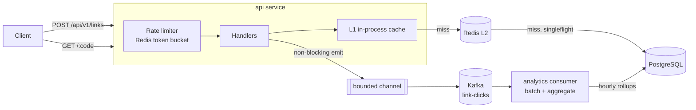

# LinkPulse

A URL shortener with click analytics, written in Go and designed for read-heavy traffic: cached redirects, rate limiting, and analytics that never slow a redirect down.

**Stack:** Go · PostgreSQL · Redis · Kafka · Prometheus · Docker

**Live demo:** _coming soon_ · open the dashboard, shorten a link, and press **Simulate 50 clicks** to watch analytics flow through Kafka in real time. (Free hosting: the first visit may take a minute to wake up.)



## Features

- Unique 7-character short codes, generated without a DB round trip per request
- Custom aliases (`/hari`), with reserved-word and collision handling
- Link expiration (`expires_at` or `expires_in`), returning `410 Gone` after expiry
- Two-level cache (in-process L1 + Redis L2) with cache-stampede protection
- Distributed rate limiting (Redis + Lua token bucket), per client IP
- Async click analytics through Kafka: totals, per day, country, device and referrer
- Web dashboard at `/` with live per-link charts and a click simulator (`DEMO_MODE`)
- Prometheus metrics, health and readiness probes, graceful shutdown
- Unit tests, integration tests against real Postgres and Redis, and a load generator

## Quick start

Needs Docker. Go is optional: the Makefile runs Go inside a container if it isn't installed.

```bash
make up            # api on :8080 + analytics consumer + postgres + redis + kafka
```

Then open **http://localhost:8080** for the dashboard, or use the API directly:

```bash
# create a link
curl -s -XPOST localhost:8080/api/v1/links \
  -d '{"url":"https://go.dev/doc/effective_go"}'
# {"code":"HUTqaHX","short_url":"http://localhost:8080/HUTqaHX", ...}

# custom alias that expires in 30 days
curl -s -XPOST localhost:8080/api/v1/links \
  -d '{"url":"https://github.com/Harisankar2000","alias":"hari","expires_in":"720h"}'

# follow it
curl -i localhost:8080/hari            # 302 Location: https://github.com/Harisankar2000

# analytics (default: last 30 days)
curl -s localhost:8080/api/v1/links/hari/stats
```

```json
{
  "code": "hari",
  "total_clicks": 4,
  "by_day":      [{"key": "2026-11-09", "clicks": 4}],
  "by_country":  [{"key": "IN", "clicks": 3}, {"key": "US", "clicks": 1}],
  "by_device":   [{"key": "mobile", "clicks": 3}, {"key": "desktop", "clicks": 1}],
  "by_referrer": [{"key": "linkedin.com", "clicks": 3}, {"key": "direct", "clicks": 1}]
}
```

## API

| Method | Path | Description |
|---|---|---|
| `POST` | `/api/v1/links` | Create. Body: `url` (required), `alias`, `expires_at` (RFC 3339) or `expires_in` (`"24h"`) |
| `GET` | `/{code}` | `302` redirect; `404` unknown; `410` expired; `429` rate limited |
| `GET` | `/api/v1/links/{code}` | Link details |
| `GET` | `/api/v1/links/{code}/stats?from=YYYY-MM-DD&to=YYYY-MM-DD` | Click analytics |
| `GET` | `/healthz`, `/readyz` | Liveness, and readiness (checks Postgres and Redis) |
| `GET` | `/metrics` | Prometheus metrics |

Errors look like `{"error": {"code": "alias_taken", "message": "..."}}`.

## Design decisions

### How are unique IDs generated at scale?

The options considered:

| Approach | Problem |
|---|---|
| Random code + "does it exist?" check | Extra read per create; collisions grow as the table fills |
| Hash of the URL (MD5 → base62) | Collisions must be handled; the same URL always gets the same code |
| Auto-increment per row | A DB round trip per create; sequential codes are guessable |
| Snowflake IDs | Unique without coordination, but ~11 characters long |

**What LinkPulse does:** a Postgres sequence with `INCREMENT BY 1000`. Each API instance calls `nextval()` once to **reserve a block of 1000 IDs** and hands them out from memory ([`shortid/allocator.go`](internal/shortid/allocator.go)). Instances never get overlapping blocks, and creates need no extra coordination.

Encoding a counter directly would give guessable codes (`0000001`, `0000002`). So each ID first goes through a **bijective scramble**, `(id × M + C) mod 62⁷` with `M` coprime to 62⁷, and is then base62-encoded to exactly 7 characters ([`shortid/shortid.go`](internal/shortid/shortid.go)). It's a permutation, so there are no collisions, and that gives **3.5 trillion** codes. Tests check uniqueness over 200k IDs, and concurrent creates from two simulated instances.

The only possible clash is a generated code equal to a custom alias. The insert uses `ON CONFLICT DO NOTHING`, and the service retries with the next ID.

### How are cache stampedes prevented?

A stampede happens when a hot key expires and thousands of concurrent requests all miss and query the database together. Four defenses:

1. **singleflight**: concurrent misses for the same code in one process share **one** DB query, with a double-check of Redis inside the flight. The integration test fires 500 concurrent requests at a cold key and asserts exactly 1 DB load.
2. **TTL jitter (±10%)**: entries cached together don't expire together.
3. **Negative caching**: unknown codes are cached as "not found" for 30s, so floods of random codes don't reach Postgres. Creating an alias clears that entry.
4. **L1 in-process cache**: hot links are served from memory and don't even touch Redis.

If Redis goes down, lookups fall back to Postgres and the rate limiter fails open: a cache outage degrades performance but doesn't cause downtime.

### How are millions of redirects handled?

- The redirect path is: L1 memory → Redis → Postgres, and almost all traffic stops at L1 or Redis.
- The API is **stateless**, so it scales horizontally behind a load balancer. The ID blocks, the Redis rate limiter and Redis cache work across instances.
- The **analytics write is off the hot path**: the handler puts the click on a bounded channel with a non-blocking `select`. If Kafka is slow, the channel fills and events are **dropped and counted** (`linkpulse_analytics_events_total{result="dropped"}`) rather than blocking redirects.
- **302, not 301**: browsers cache a 301 permanently, so repeat clicks would never reach the server and couldn't be counted.
- Server timeouts, a 8 KB request body cap, and `MaxBytesReader` protect against slow or oversized clients.

### How is analytics data stored efficiently?

Storing one row per click doesn't scale: a viral link means millions of rows. Instead:

- Clicks are published to Kafka **keyed by short code**, so one consumer owns each link's rows (no write contention).
- The consumer polls up to 10k records, **aggregates them in memory**, and writes one upsert per `(code, hour, country, device, referrer)` in a single transaction, using `clicks = clicks + EXCLUDED.clicks`.
- A link with 1M clicks per day from 20 countries becomes a few hundred rows instead of 1M.
- Offsets are committed **after** the DB transaction, giving at-least-once delivery. A crash between the two can double-count one batch; exact counts would need offsets stored in the same transaction.
- User-Agent and Referer parsing happens in the consumer, not in the redirect handler. **IP addresses are never stored.**

Geo data comes from CDN headers (`CF-IPCountry`, `X-Vercel-IP-Country`, `CloudFront-Viewer-Country`). Running locally without a CDN, clicks show as `XX` unless you send the header yourself.

## Benchmarks

`make loadtest` creates 200 links, then runs 64 concurrent workers against redirects for 20s, with skewed traffic (a few links take most clicks, as in real life). Rate limits are disabled for the run.

| Setup | Throughput | p50 | p99 | Errors |
|---|---|---|---|---|
| Redis-only cache | ~3,000 req/s | 18.3 ms | 66 ms | 0 |
| **L1 + Redis cache** | **~5,500 req/s** | **8.8 ms** | **48 ms** | **0** |

Measured on a 4-core laptop with **everything on one machine** (API, load generator, Kafka, Postgres and Redis, at a load average around 10). These numbers are a lower bound, not a ceiling. The API used about 0.8 CPU and 23 MB RAM.

## Project layout

```
cmd/
  api/          HTTP server: wiring, graceful shutdown
  analytics/    Kafka consumer → Postgres rollups
  loadgen/      load generator
internal/
  shortid/      block allocator, scramble, base62
  links/        business rules: validation, aliases, expiry
  cache/        L1 + Redis cache, singleflight, negative caching
  ratelimit/    Redis + Lua token bucket
  analytics/    click events, emitter, consumer, UA/referrer parsing
  store/        PostgreSQL (pgx), embedded migrations
  httpapi/      routes, handlers, middleware
  metrics/      Prometheus metrics
```

## Development

```bash
make test               # unit tests with -race
make test-integration   # real Postgres + Redis (run `make up` first)
make lint               # go vet + gofmt check
make loadtest           # benchmark redirects
make logs               # follow api + analytics logs
make clean              # stop everything and delete data
```

| Variable | Default | Meaning |
|---|---|---|
| `BASE_URL` | `http://localhost:8080` | Prefix for returned short URLs |
| `CACHE_TTL` / `NEGATIVE_CACHE_TTL` | `24h` / `30s` | Redis TTLs |
| `RATE_CREATE_PER_MIN` / `RATE_CREATE_BURST` | `30` / `10` | Create limit per IP (`0` disables) |
| `RATE_REDIRECT_RPS` / `RATE_REDIRECT_BURST` | `100` / `200` | Redirect limit per IP (`0` disables) |
| `TRUST_PROXY_HEADERS` | `false` | Use `X-Forwarded-For` for client IP (only behind a trusted proxy) |
| `REDIS_NAMESPACE` | `lp:` | Prefix on every Redis key, so LinkPulse can share a Redis database |
| `EVENT_BUFFER_SIZE` | `10000` | Click events buffered before dropping |
| `DEMO_MODE` | `false` | Enables the dashboard's click simulator |
| `ANALYTICS_IN_PROCESS` | `false` | Run the Kafka consumer inside the API process (single-service hosting) |
| `KAFKA_TLS`, `KAFKA_CA_CERT`, `KAFKA_CLIENT_CERT`, `KAFKA_CLIENT_KEY` | empty | TLS / mutual TLS for hosted Kafka |
| `KAFKA_SASL_MECHANISM`, `KAFKA_USERNAME`, `KAFKA_PASSWORD` | empty | SASL (`PLAIN`, `SCRAM-SHA-256`, `SCRAM-SHA-512`) |

## Deployment

The free hosted demo runs on Render + Neon + Upstash + Aiven Kafka. See [DEPLOY.md](DEPLOY.md).

## What I'd add next

- API keys and per-user link ownership; delete or disable links
- Store raw clicks in ClickHouse for ad-hoc queries, keeping Postgres rollups for the dashboard
- Exactly-once analytics by storing Kafka offsets in the rollup transaction
- Prefetch the next ID block in the background, so a create never waits on `nextval()`
- Grafana dashboard for the Prometheus metrics, plus OpenTelemetry tracing
- Malicious-URL screening (e.g. Google Safe Browsing) before shortening
